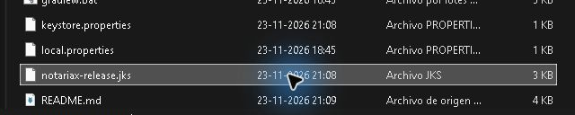

# NotariaX 📄

Aplicación móvil desarrollada en **Android (Kotlin)** con **Jetpack Compose** para simplificar trámites notarialmente simulados de forma rápida, segura y accesible.

## 🚀 Características Principales

- **Inicio de Sesión Seguro (Login):** Validación de RUT y persistencia de sesión del usuario utilizando **Room Database**.
- **Gestión de Trámites:** Formulario interactivo para la solicitud de antecedentes y declaración jurada.
- **Captura de Documentos Base:** Integración con el recurso nativo de la **Cámara** mediante permisos en tiempo de ejecución (`Manifest.permission.CAMERA`).
- **Firma Electrónica:** Validación con E-Token y generación de **Notificaciones Locales** al completar la firma del documento.
- **Navegación Fluida:** Manejo de estado y flujo entre pantallas con **Navigation Compose** y animaciones.
- **API externa:** Consulta de publicaciones, comentarios, álbumes, fotos, tareas y usuarios con Retrofit.

## 🛠️ Arquitectura y Tecnologías

El proyecto sigue el patrón de arquitectura **MVVM (Model-View-ViewModel)** recomendado por Google, logrando desacoplar totalmente la interfaz gráfica de la lógica de negocio y persistencia.

- **Lenguaje:** Kotlin
- **UI:** Jetpack Compose (Material3)
- **Persistencia:** Room Database
- **Asincronía:** Kotlin Coroutines & StateFlow
- **Consumo REST:** Retrofit 2 y Gson
- **Navegación:** Navigation Compose
- **Recursos Nativos:** Cámara (CameraX / Intent Image Capture) y Notificaciones del sistema (`NotificationManager`)

## 📁 Estructura del proyecto

```text
app/src/main/java/com/example/notariax/
├── data/
│   ├── local/        # Persistencia local con Room
│   └── repository/   # Acceso a los datos
├── model/            # Entidades del dominio y de Room
├── ui/
│   ├── navigation/  # Rutas y navegación entre pantallas
│   └── theme/       # Colores y tema visual
├── view/             # Pantallas Jetpack Compose
├── viewmodel/        # Estado y acciones de cada pantalla
└── MainActivity.kt   # Punto de entrada de la aplicación
```

## 📋 Requisitos e Instalación

1. Clonar el repositorio:
   ```bash
   git clone https://github.com/Faneto777/NotariaX.git
   ```
2. Abrir el proyecto en **Android Studio (Ladybug o posterior)**.
3. Sincronizar el proyecto con Gradle (`Sync Project with Gradle Files`).
4. Ejecutar en un emulador Android (API 24+) o dispositivo físico.

## 🧪 Evaluación 4: API externa y pruebas

La pantalla Home consulta [JSONPlaceholder](https://jsonplaceholder.typicode.com/), una API pública de datos de prueba. La solicitud `POST /posts` es demostrativa: la API devuelve una respuesta, pero no conserva el registro.

Rutas consumidas desde `ExternalApiService`:

| Método | Ruta |
| --- | --- |
| GET | `/posts` |
| GET | `/posts/{id}` |
| GET | `/comments` |
| GET | `/albums` |
| GET | `/photos` |
| GET | `/todos` |
| GET | `/users` |
| POST | `/posts` |

Las pruebas unitarias de `LoginViewModel` y `RegisterViewModel` usan JUnit, MockK y un dispatcher de coroutines de prueba:

```powershell
.\gradlew.bat :app:testDebugUnitTest
```

## 📦 APK de release firmado

El proyecto requiere JDK 17 para ejecutar Gradle. El criterio del daemon está en `gradle/gradle-daemon-jvm.properties`; si Android Studio solicita descargarlo, acepta JDK 17.

Para generar el APK firmado, ejecuta desde la carpeta del proyecto:

```powershell
.\gradlew.bat :app:assembleRelease
```

El APK queda en `app/build/outputs/apk/release/app-release.apk`. La llave `notariax-release.jks` y el archivo local `keystore.properties` no se incluyen en Git para no publicar la llave ni sus contraseñas.

Capturas de los archivos generados localmente:

| APK firmado | Llave de firma local |
| --- | --- |
|  |  |

> La conexión al backend Spring Boot del equipo se documentará aquí cuando se cierre el contrato de rutas y JSON con la persona responsable del backend.

---
*Proyecto educativo desarrollado para la asignatura DSY1105.*
