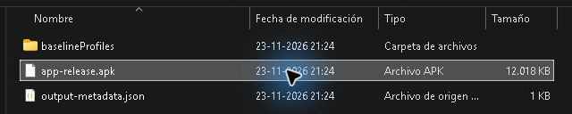

# NotariaX 📄

Aplicación móvil desarrollada en **Android (Kotlin)** con **Jetpack Compose** para simplificar trámites notarialmente simulados de forma rápida, segura y accesible.

## 🚀 Características Principales

- **Inicio de Sesión:** Autenticación del backend por correo y persistencia local de la sesión con **Room Database**.
- **Gestión de Trámites:** Envío al backend de solicitudes con antecedentes y estado.
- **Captura de Documentos Base:** Integración con el recurso nativo de la **Cámara** mediante permisos en tiempo de ejecución (`Manifest.permission.CAMERA`).
- **Firma Electrónica:** Registro de la firma del trámite en el backend y generación de **Notificaciones Locales**.
- **Navegación Fluida:** Manejo de estado y flujo entre pantallas con **Navigation Compose** y animaciones.
- **API externa:** Consulta de publicaciones, comentarios, álbumes, fotos, tareas y usuarios con Retrofit.
- **Backend Spring Boot:** Registro, inicio de sesión, recuperación, perfil, trámites y firmas mediante Retrofit.

## 🛠️ Arquitectura y Tecnologías

El proyecto sigue el patrón de arquitectura **MVVM (Model-View-ViewModel)** recomendado por Google, logrando desacoplar totalmente la interfaz gráfica de la lógica de negocio y persistencia.

- **Lenguaje:** Kotlin
- **UI:** Jetpack Compose (Material3)
- **Persistencia:** Room Database
- **Asincronía:** Kotlin Coroutines & StateFlow
- **Consumo REST:** Retrofit 2 y Gson
- **Navegación:** Navigation Compose
- **Recursos Nativos:** Cámara (CameraX / Intent Image Capture) y Notificaciones del sistema (`NotificationManager`)

## 📁 Estructura del proyecto

```text
app/src/main/java/com/example/notariax/
├── data/
│   ├── local/        # Persistencia local con Room
│   └── repository/   # Acceso a los datos
├── model/            # Entidades del dominio y de Room
├── ui/
│   ├── navigation/  # Rutas y navegación entre pantallas
│   └── theme/       # Colores y tema visual
├── view/             # Pantallas Jetpack Compose
├── viewmodel/        # Estado y acciones de cada pantalla
└── MainActivity.kt   # Punto de entrada de la aplicación
```

## 📋 Requisitos e Instalación

1. Clonar el repositorio:
   ```bash
   git clone https://github.com/Faneto777/NotariaX.git
   ```
2. Abrir el proyecto en **Android Studio (Ladybug o posterior)**.
3. Sincronizar el proyecto con Gradle (`Sync Project with Gradle Files`).
4. Ejecutar en un emulador Android (API 24+) o dispositivo físico.

## 🧪 Evaluación 4: API externa y pruebas

La pantalla Home consulta [JSONPlaceholder](https://jsonplaceholder.typicode.com/), una API pública de datos de prueba. La solicitud `POST /posts` es demostrativa: la API devuelve una respuesta, pero no conserva el registro.

Rutas consumidas desde `ExternalApiService`:

| Método | Ruta |
| --- | --- |
| GET | `/posts` |
| GET | `/posts/{id}` |
| GET | `/comments` |
| GET | `/albums` |
| GET | `/photos` |
| GET | `/todos` |
| GET | `/users` |
| POST | `/posts` |

Las pruebas unitarias de `LoginViewModel` y `RegisterViewModel` usan JUnit, MockK y un dispatcher de coroutines de prueba:

```powershell
.\gradlew.bat :app:testDebugUnitTest
```

Para generar el reporte JaCoCo de esos dos ViewModels y verificar que cada paquete mantenga al menos 80% de cobertura de líneas, ejecuta:

```powershell
.\gradlew.bat :app:jacocoViewModelCoverageReport
```

El reporte HTML queda en `app/build/reports/jacoco/jacocoViewModelCoverageReport/html/index.html`. La tarea falla si Login o Registro baja del 80%.

## 🔌 Backend Spring Boot del equipo

La aplicación se conecta al backend Spring Boot del equipo con Retrofit y Gson. La URL está configurada en `BackendRetrofitClient` como `http://10.0.2.2:8080/`; las rutas no llevan prefijo `/api`. `10.0.2.2` permite que el emulador Android acceda al PC que lo está ejecutando.

Para probar la aplicación, abre el proyecto backend en IntelliJ y ejecuta `NotariaxBackendApplication`. Debe permanecer activo en el puerto `8080` mientras se usa la app. En un dispositivo físico, cambia la URL base por la dirección IP del PC accesible desde el teléfono. El manifest permite tráfico HTTP sin cifrar para el entorno local del curso.

### Contrato de endpoints

Los nombres de los campos JSON son camelCase y coinciden con los DTOs de `data/remote/dto/BackendDtos.kt`.

| Método | Ruta | Body | Respuesta del backend |
| --- | --- | --- | --- |
| POST | `/usuarios/registro` | `rut`, `nombreCompleto`, `email`, `password` | `201` con usuario; `409` si el RUT ya existe |
| POST | `/usuarios/login` | `email`, `password` | `200` con usuario; `401` si las credenciales no coinciden |
| POST | `/usuarios/recuperar` | `email` | `200` sin body |
| GET | `/usuarios/{rut}` | — | `200` con usuario; `404` si no existe |
| PUT | `/usuarios/{rut}` | `rut`, `nombreCompleto`, `email`, `password` | `200` con usuario; `password: null` conserva la actual |
| DELETE | `/usuarios/{rut}` | — | `204`; `404` si no existe |
| POST | `/tramites` | `tipoTramite`, `antecedentes`, `documentoAdjunto`, `estado` | `201` con trámite, `id` y `fechaCreacion` |
| GET | `/tramites` | — | `200` con la lista de trámites |
| GET | `/tramites/{id}` | — | `200` con trámite; `404` si no existe |
| PUT | `/tramites/{id}` | `tipoTramite`, `antecedentes`, `documentoAdjunto`, `estado` | `200` con trámite; `404` si no existe |
| DELETE | `/tramites/{id}` | — | `204`; `404` si no existe |
| POST | `/firmas` | `tramiteId`, `firmado` | `201` con firma; `fechaFirma` se asigna al firmar |
| GET | `/firmas/tramite/{tramiteId}` | — | `200` con firma; `404` si no existe |

El servicio Retrofit declara los 13 endpoints y `BackendRepository` los expone a la app. Las pantallas actuales usan registro, login, perfil, creación de trámite y firma; las rutas de edición, eliminación y listado quedan disponibles en el repositorio para las pantallas CRUD que se agreguen.

La recuperación registra la solicitud, pero el backend actual no envía correos. El PIN de firma se valida en la app y no se envía al backend. La firma del backend recibe únicamente `tramiteId` y `firmado`.

En esta versión académica, el backend almacena contraseñas en texto plano.

## 📦 APK de release firmado

El proyecto requiere JDK 17 para ejecutar Gradle. El criterio del daemon está en `gradle/gradle-daemon-jvm.properties`; si Android Studio solicita descargarlo, acepta JDK 17.

Para generar el APK firmado, ejecuta desde la carpeta del proyecto:

```powershell
.\gradlew.bat :app:assembleRelease
```

El APK queda en `app/build/outputs/apk/release/app-release.apk`. La llave `notariax-release.jks` y el archivo local `keystore.properties` no se incluyen en Git para no publicar la llave ni sus contraseñas.

Capturas de los archivos generados localmente:

| APK firmado | Llave de firma local |
| --- | --- |
|  |  |

---
*Proyecto educativo desarrollado para la asignatura DSY1105.*
